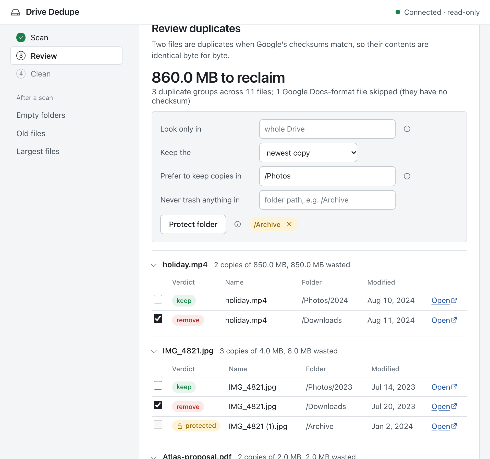
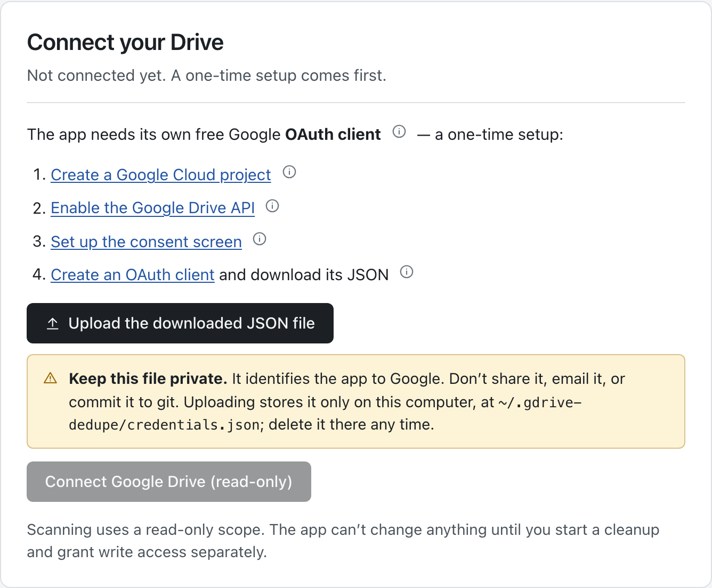
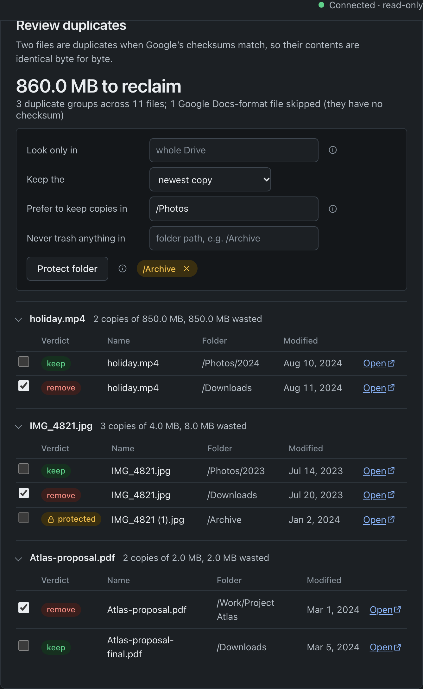
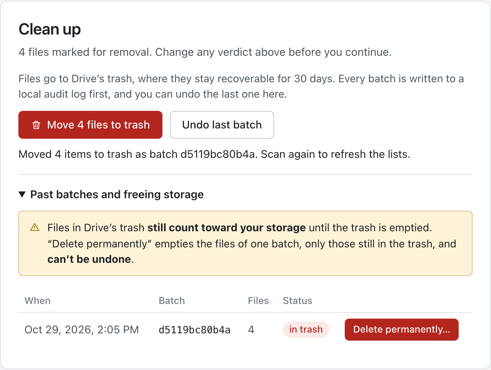
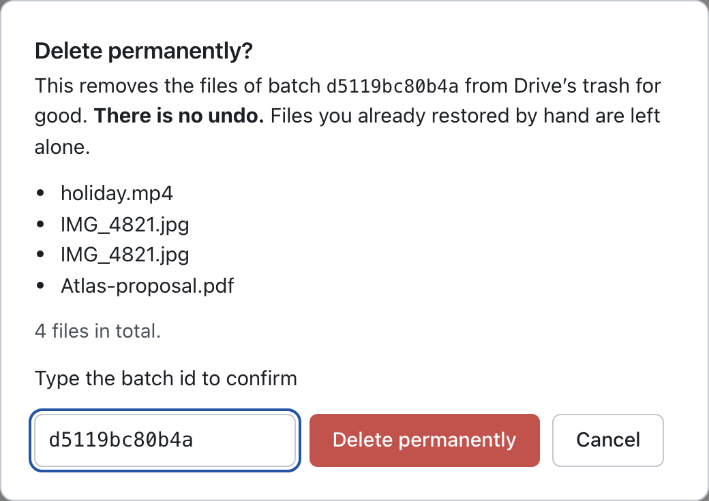
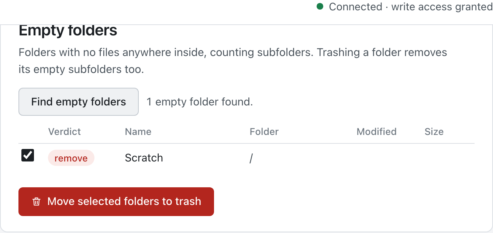
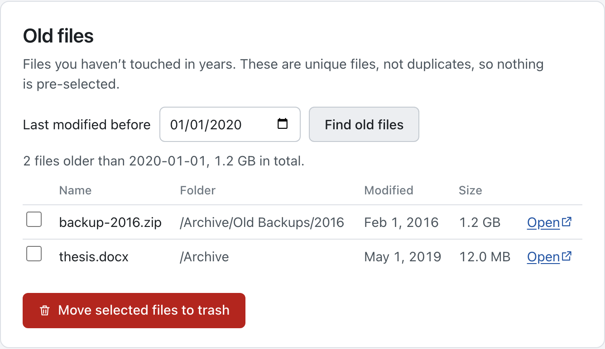
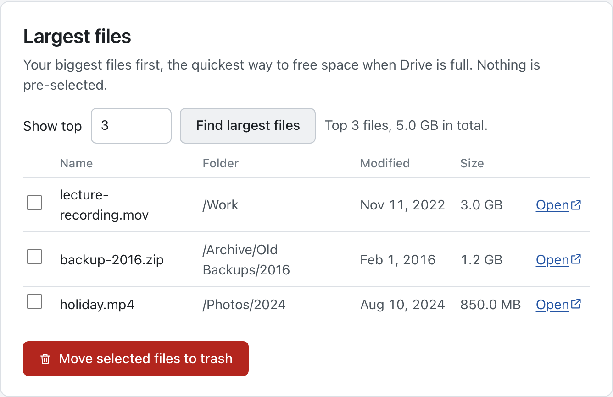

# Drive Dedupe

[](https://github.com/moraneus/Google-Drive-Remove-Duplicates/actions/workflows/ci.yml)


Find and **safely** remove duplicate files in your Google Drive — from a local web
interface or the command line. Duplicates are detected by comparing the MD5 checksums
Google already stores for every binary file, so a match means the file *content* is
byte-for-byte identical.

Everything runs on your own machine. Your OAuth credentials and token never leave it,
and nothing is ever permanently deleted — files only go to Drive's trash, with a local
audit log and one-click undo.

> Looking for the original single-script version? It's preserved at
> [v1.0.0](https://github.com/moraneus/Google-Drive-Remove-Duplicates/releases/tag/v1.0.0).



## Features

- **Exact detection** — files are grouped by MD5 checksum; only true content duplicates
  are reported, with folder paths, sizes, and modification dates to help you decide.
- **Web UI and CLI** — a local browser interface (`gdrive-dedupe web`) and a scriptable
  CLI (`gdrive-dedupe scan` / `clean` / `undo`) share the same engine.
- **Read-only by default** — scanning uses the `drive.metadata.readonly` scope; the app
  *cannot* modify your Drive until you explicitly grant write access for cleanup.
- **Dry-run by default** — `clean` only prints its plan unless you pass `--apply`, and
  the web UI always shows a confirmation dialog listing exactly what will be trashed.
- **Trash only, with undo** — nothing is permanently deleted. Every batch is recorded
  in a local audit log, and the last batch can be restored with one command or click.
- **Keep rules** — keep the newest, oldest or shallowest copy; prefer copies in a
  folder you name; and mark folders as *protected* so nothing inside them is ever
  trashed (the app refuses, even if you tick it).
- **Folder scope** — narrow a scan to one folder subtree, no re-scan needed.
- **Empty-folder cleanup** — finds folders with no files anywhere inside them
  (recursively) and removes them in one confirmed batch.
- **Old-file finder** — lists files last modified before a date you choose, so you can
  review and clear out ancient files.
- **Largest files** — your biggest files first, the fastest way out when Drive is full.
- **Actually free the space** — trashed files still count toward your quota; an explicit
  *Delete permanently* step empties one batch from the trash, after you type its id.
- **Docker image** — run the web UI in a container, with the same safety model.
- **Only your files** — files merely *shared with you* are never touched.
- **Private** — no telemetry, no third-party servers; the web server binds to
  `127.0.0.1` only, and the page loads no fonts, scripts or styles from anywhere else.
- **Quiet interface** — a document-like page in your system's light or dark theme, with
  a written verdict (*keep*, *remove*, *protected*) on every file so nothing rides on
  color alone. Keyboard and screen-reader friendly, and usable on a phone.

## Safety model

1. Two-tier OAuth: read-only scope for scanning, separate explicit consent for cleanup.
2. Token stored as plain JSON at `~/.gdrive-dedupe/token.json` with `0600` permissions.
3. Dry-run/confirmation before any change.
4. Trash-only mutations — recoverable from Drive's trash (Google keeps trashed files 30 days).
   The single exception is *purge*: permanent deletion of one batch **this tool** trashed,
   only after you type the batch id, and only for files still in the trash.
5. Audit log of every batch at `~/.gdrive-dedupe/audit.jsonl`, written *before* trashing.
6. Undo restores the most recent batch that has not been purged.
7. Protected folders are enforced server-side, not just in the UI.

Details in [SECURITY.md](SECURITY.md).

## Quick start

### 1. Install

```bash
git clone https://github.com/moraneus/Google-Drive-Remove-Duplicates.git
cd Google-Drive-Remove-Duplicates
uv sync          # or: pip install .
```

### 2. Run

```bash
uv run gdrive-dedupe web
```

Your browser opens at `http://127.0.0.1:8765`. On first run the app walks you through
the one-time Google setup right in the page — step-by-step links to create your own
(free) OAuth client, hover tooltips explaining each step, and an upload button that
stores the downloaded `credentials.json` in the right place (`~/.gdrive-dedupe/`,
private to this computer):



Then: Connect, scan, review, clean.

### Or run it in Docker

```bash
docker compose up --build        # or: docker build -t gdrive-dedupe . && docker run …
```

The container prints a URL like `http://127.0.0.1:8765/?token=…` — open **that exact
URL**; the token is required because the server listens on all interfaces inside the
container. Both ports are published on `127.0.0.1` only. Your `credentials.json`,
token and audit log live in the `gdrive-dedupe-data` volume (`/data`). Google's consent
redirect comes back through port 8766, so keep it published too. If no browser tab opens
during Connect, the page shows the consent link to click.

See [docker-compose.yml](docker-compose.yml) for the knobs
(`GDRIVE_DEDUPE_TOKEN` pins the token across restarts).

<details>
<summary>Prefer doing the Google setup manually?</summary>

1. Go to the [Google Cloud Console](https://console.cloud.google.com/) and create a project.
2. Enable the **Google Drive API** (APIs & Services → Library).
3. Configure the **OAuth consent screen**: External, fill in the app name and your
   email, and add your Google account as a **test user**.
4. Create credentials → **OAuth client ID** → application type **Desktop app**.
5. Download the JSON and save it as `credentials.json` in the project directory
   (or in `~/.gdrive-dedupe/`).

</details>

## Web UI

The side rail tracks four steps; the three tools appear under it after a scan.

1. **Connect** — authorize read-only access via Google's consent screen.
2. **Scan** — fetches file metadata (no file contents are downloaded) with live progress.
3. **Review** — duplicate groups sorted by wasted space, each file with a verdict pill.
   Keep rules pre-select which copies to remove; every checkbox is yours to override,
   and each file links to Drive so you can look before you leap.
   - **Look only in** a folder to scope the review (and the tools below) to that subtree.
     Duplicates are then pairs that both live inside it.
   - **Keep the** newest, oldest, or the copy *closest to the top* of your folder tree.
   - **Prefer to keep copies in** a folder: when a group has a copy there, that one is
     kept whatever the strategy says.
   - **Never trash anything in** protected folders: those copies show a *protected*
     verdict with a lock, and the server refuses to trash them. When a group has a protected copy, it becomes the
     keeper so the others can go.
4. **Clean** — confirmation dialog → files move to Drive's trash → **Undo** if you
   change your mind.


The same page in dark mode, which follows your system setting:



Nothing is trashed without an explicit confirmation listing every affected file:


**Freeing the space for real.** Files in Drive's trash still count toward your storage
quota until the trash is emptied. The Clean stage keeps a history of your batches; each
one still in the trash has a *Delete permanently…* button:



Permanent deletion asks you to type the batch id, deletes only files that are still in
the trash (anything you restored by hand is skipped), and cannot be undone:



After a scan, two extra tools use the same data — no additional API calls:

**Empty folders** — folders whose entire subtree contains no files. Only the topmost
empty folders are listed; trashing them covers their empty subfolders.



**Older files** — everything last modified before a date you pick. These are unique
files, so nothing is pre-selected.



**Largest files** — your biggest files, largest first. Nothing is pre-selected.



*Screenshots show demo data.*

## CLI usage

```bash
uv run gdrive-dedupe scan                  # report duplicates (read-only)
uv run gdrive-dedupe scan --json out.json  # also write a JSON report
uv run gdrive-dedupe scan --folder /Photos # only look inside one folder subtree
uv run gdrive-dedupe clean                 # DRY RUN: show what would be trashed
uv run gdrive-dedupe clean --apply         # trash duplicates, keeping the newest copy
uv run gdrive-dedupe clean --strategy oldest --apply      # keep the oldest copy instead
uv run gdrive-dedupe clean --strategy shallowest --apply  # keep the copy closest to the top
uv run gdrive-dedupe clean --prefer /Photos --apply       # keep the copy in /Photos when there is one
uv run gdrive-dedupe clean --protect /Archive --protect /Work --apply   # never trash inside these
uv run gdrive-dedupe undo                  # restore the last trashed batch
uv run gdrive-dedupe web --port 9000       # web UI on another port
uv run gdrive-dedupe web --no-browser      # don't open a browser tab (print the URL only)

uv run gdrive-dedupe empty-folders                     # list folders with no files inside
uv run gdrive-dedupe empty-folders --apply             # ...and move them to trash
uv run gdrive-dedupe old-files --before 2020-01-01     # list files not modified since 2020
uv run gdrive-dedupe old-files --before 2020-01-01 --apply   # ...and move them to trash
uv run gdrive-dedupe largest-files --limit 20          # your 20 biggest files
uv run gdrive-dedupe largest-files --limit 20 --apply  # ...and trash the ones you confirm

uv run gdrive-dedupe purge                 # list past batches and their status
uv run gdrive-dedupe purge --batch <id>    # show what permanent deletion would remove
uv run gdrive-dedupe purge --batch <id> --apply   # delete for good (asks you to type the id)
```

`--folder`, `--prefer` and `--protect` take a folder path like `/Photos/2023` (or a
folder id). `--folder` also works with `empty-folders`, `old-files` and `largest-files`.

## How duplicates are detected

- Google Drive stores an MD5 checksum for every binary file; two files with the same
  checksum have identical content regardless of name or folder.
- Google-native files (Docs, Sheets, Slides) have no checksum and are skipped — the
  scan reports how many were skipped.
- Only files **owned by you** in My Drive are considered; shared files and shared
  drives are out of scope.
- With a folder scope, only copies *inside* that folder count — a file that has its
  twin elsewhere in Drive is not reported as a duplicate of the scoped folder.

## FAQ

**Why does cleanup ask me to consent again?**
Scanning uses a read-only scope. Trashing requires the full Drive scope, so the app
re-runs the consent flow the first time you clean — least privilege by design.

**Where do my token and audit log live?**
In `~/.gdrive-dedupe/` (`token.json`, `audit.jsonl`). Delete the directory to reset.

**What if I trash the wrong file?**
Use *Undo* (web) or `gdrive-dedupe undo` (CLI) to restore the last batch, or restore
manually from [drive.google.com/drive/trash](https://drive.google.com/drive/trash).
Google keeps trashed files for 30 days.

**I cleaned up, but Drive still says it's full.**
Trashed files keep using your quota until the trash is emptied. Either empty Drive's
trash yourself, or use *Delete permanently* on a batch (web) / `gdrive-dedupe purge`
(CLI). Both only touch files this tool trashed that are still in the trash, and both
make you type the batch id first. There is no undo after that.

**Does anything leave my machine?**
Only API calls to Google. No other network traffic, no telemetry.

**Can I run it on a NAS or another machine?**
Yes, with Docker or `gdrive-dedupe web --host <address>`. Whenever the server is not
bound to loopback it requires an access token (printed at startup, carried in the URL),
and it only answers requests addressed to the hosts it knows (`127.0.0.1`, `localhost`,
the `--host` value, and `GDRIVE_DEDUPE_ALLOWED_HOSTS`). Google's consent redirect must
reach the server too: set `GDRIVE_DEDUPE_OAUTH_PORT` to a fixed port and publish it.

## Revoking access / cleanup

When you're done with the tool:

1. Revoke the app's access at [Google Account Permissions](https://myaccount.google.com/permissions).
2. Delete the OAuth client at [Google Cloud Credentials](https://console.cloud.google.com/apis/credentials)
   (or delete the whole project).
3. Delete `~/.gdrive-dedupe/` and your local `credentials.json`.

## Configuration

| Variable | Default | Meaning |
|---|---|---|
| `GDRIVE_DEDUPE_HOME` | `~/.gdrive-dedupe` | Where `credentials.json`, `token.json` and `audit.jsonl` live |
| `GDRIVE_DEDUPE_HOST` | `127.0.0.1` | Default for `web --host` |
| `GDRIVE_DEDUPE_TOKEN` | *(generated when not on loopback)* | Access token the web UI must present |
| `GDRIVE_DEDUPE_ALLOWED_HOSTS` | *(none)* | Extra host names the web server answers to, comma separated |
| `GDRIVE_DEDUPE_OAUTH_PORT` | random free port | Port for Google's consent redirect (`http://localhost:<port>/`) |
| `GDRIVE_DEDUPE_OAUTH_BIND` | `127.0.0.1` | Address the redirect listener binds to (`0.0.0.0` in containers) |
| `GDRIVE_DEDUPE_NO_BROWSER` | unset | Set to `1` to never open a browser; the UI shows the consent link instead |

## Development

```bash
uv sync                    # install with dev dependencies
uv run pytest              # run the test suite (no Google account needed)
uv run ruff check .        # lint
uv run ruff format .       # format
docker build -t gdrive-dedupe:ci . && scripts/docker-smoke.sh   # what CI runs for the image
```

Architecture overview: [docs/architecture.md](docs/architecture.md).
Changelog: [CHANGELOG.md](CHANGELOG.md).

## License & disclaimer

MIT. This tool moves files to Drive's trash on your explicit instruction; review the
plan before applying it. The author is not responsible for data loss — always keep
backups of important files.
