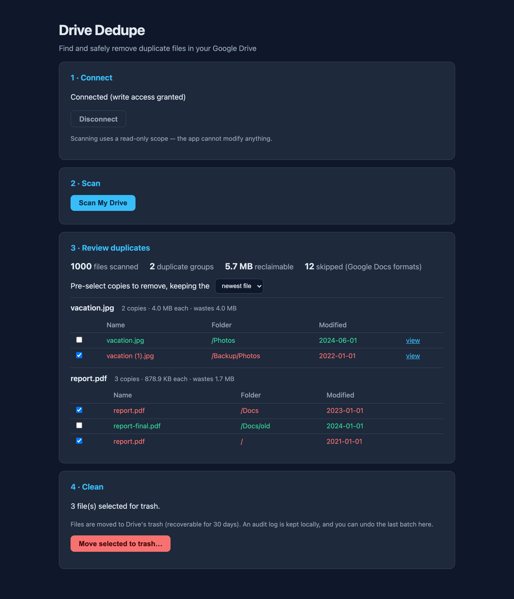
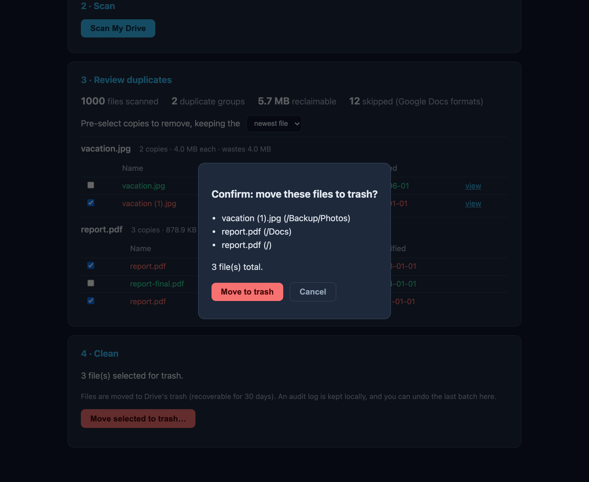

# Drive Dedupe

[](https://github.com/moraneus/Google-Drive-Remove-Duplicates/actions/workflows/ci.yml)


Find and **safely** remove duplicate files in your Google Drive — from a local web
interface or the command line. Duplicates are detected by comparing the MD5 checksums
Google already stores for every binary file, so a match means the file *content* is
byte-for-byte identical.

Everything runs on your own machine. Your OAuth credentials and token never leave it,
and nothing is ever permanently deleted — files only go to Drive's trash, with a local
audit log and one-click undo.

> Looking for the original single-script version? It's preserved at
> [v1.0.0](https://github.com/moraneus/Google-Drive-Remove-Duplicates/releases/tag/v1.0.0).

## Features

- **Exact detection** — files are grouped by MD5 checksum; only true content duplicates
  are reported, with folder paths, sizes, and modification dates to help you decide.
- **Web UI and CLI** — a local browser interface (`gdrive-dedupe web`) and a scriptable
  CLI (`gdrive-dedupe scan` / `clean` / `undo`) share the same engine.
- **Read-only by default** — scanning uses the `drive.metadata.readonly` scope; the app
  *cannot* modify your Drive until you explicitly grant write access for cleanup.
- **Dry-run by default** — `clean` only prints its plan unless you pass `--apply`, and
  the web UI always shows a confirmation dialog listing exactly what will be trashed.
- **Trash only, with undo** — nothing is permanently deleted. Every batch is recorded
  in a local audit log, and the last batch can be restored with one command or click.
- **Only your files** — files merely *shared with you* are never touched.
- **Private** — no telemetry, no third-party servers; the web server binds to
  `127.0.0.1` only.

## Safety model

1. Two-tier OAuth: read-only scope for scanning, separate explicit consent for cleanup.
2. Token stored as plain JSON at `~/.gdrive-dedupe/token.json` with `0600` permissions.
3. Dry-run/confirmation before any change.
4. Trash-only mutations — recoverable from Drive's trash (Google keeps trashed files 30 days).
5. Audit log of every batch at `~/.gdrive-dedupe/audit.jsonl`, written *before* trashing.
6. Undo restores the most recent batch.

Details in [SECURITY.md](SECURITY.md).

## Quick start

### 1. Install

```bash
git clone https://github.com/moraneus/Google-Drive-Remove-Duplicates.git
cd Google-Drive-Remove-Duplicates
uv sync          # or: pip install .
```

### 2. Create Google OAuth credentials (one-time, ~5 minutes)

The app talks directly to the Google Drive API as *you*, so it needs an OAuth client
of your own:

1. Go to the [Google Cloud Console](https://console.cloud.google.com/) and create a project.
2. Enable the **Google Drive API** (APIs & Services → Library).
3. Configure the **OAuth consent screen**: External, fill in the app name and your
   email, and add your Google account as a **test user**.
4. Create credentials → **OAuth client ID** → application type **Desktop app**.
5. Download the JSON and save it as `credentials.json` in the project directory
   (or in `~/.gdrive-dedupe/`).

### 3. Run

```bash
uv run gdrive-dedupe web
```

Your browser opens at `http://127.0.0.1:8765`. Connect, scan, review, clean.

## Web UI

The interface walks through four stages:

1. **Connect** — authorize read-only access via Google's consent screen.
2. **Scan** — fetches file metadata (no file contents are downloaded) with live progress.
3. **Review** — duplicate groups sorted by wasted space. A keep-strategy (newest/oldest)
   pre-selects which copies to remove; every checkbox is yours to override, and each
   file links to Drive so you can look before you leap.
4. **Clean** — confirmation dialog → files move to Drive's trash → **Undo** if you
   change your mind.



Nothing is trashed without an explicit confirmation listing every affected file:



*Screenshots show demo data.*

## CLI usage

```bash
uv run gdrive-dedupe scan                  # report duplicates (read-only)
uv run gdrive-dedupe scan --json out.json  # also write a JSON report
uv run gdrive-dedupe clean                 # DRY RUN: show what would be trashed
uv run gdrive-dedupe clean --apply         # trash duplicates, keeping the newest copy
uv run gdrive-dedupe clean --strategy oldest --apply   # keep the oldest copy instead
uv run gdrive-dedupe undo                  # restore the last trashed batch
uv run gdrive-dedupe web --port 9000       # web UI on another port
```

## How duplicates are detected

- Google Drive stores an MD5 checksum for every binary file; two files with the same
  checksum have identical content regardless of name or folder.
- Google-native files (Docs, Sheets, Slides) have no checksum and are skipped — the
  scan reports how many were skipped.
- Only files **owned by you** in My Drive are considered; shared files and shared
  drives are out of scope.

## FAQ

**Why does cleanup ask me to consent again?**
Scanning uses a read-only scope. Trashing requires the full Drive scope, so the app
re-runs the consent flow the first time you clean — least privilege by design.

**Where do my token and audit log live?**
In `~/.gdrive-dedupe/` (`token.json`, `audit.jsonl`). Delete the directory to reset.

**What if I trash the wrong file?**
Use *Undo* (web) or `gdrive-dedupe undo` (CLI) to restore the last batch, or restore
manually from [drive.google.com/drive/trash](https://drive.google.com/drive/trash).
Google keeps trashed files for 30 days.

**Does anything leave my machine?**
Only API calls to Google. No other network traffic, no telemetry.

## Revoking access / cleanup

When you're done with the tool:

1. Revoke the app's access at [Google Account Permissions](https://myaccount.google.com/permissions).
2. Delete the OAuth client at [Google Cloud Credentials](https://console.cloud.google.com/apis/credentials)
   (or delete the whole project).
3. Delete `~/.gdrive-dedupe/` and your local `credentials.json`.

## Development

```bash
uv sync                    # install with dev dependencies
uv run pytest              # run the test suite (no Google account needed)
uv run ruff check .        # lint
uv run ruff format .       # format
```

Architecture overview: [docs/architecture.md](docs/architecture.md).
Changelog: [CHANGELOG.md](CHANGELOG.md).

## License & disclaimer

MIT. This tool moves files to Drive's trash on your explicit instruction; review the
plan before applying it. The author is not responsible for data loss — always keep
backups of important files.
